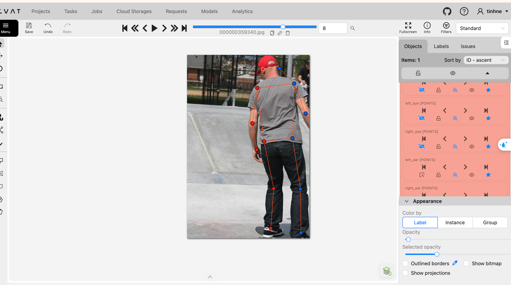
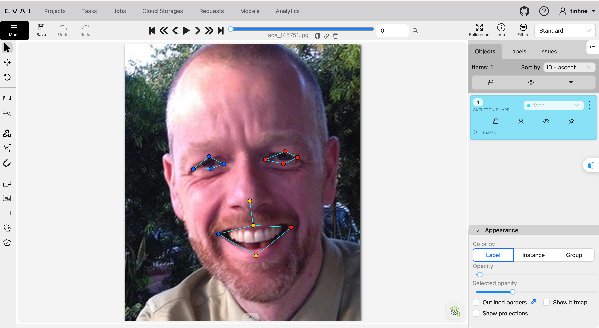
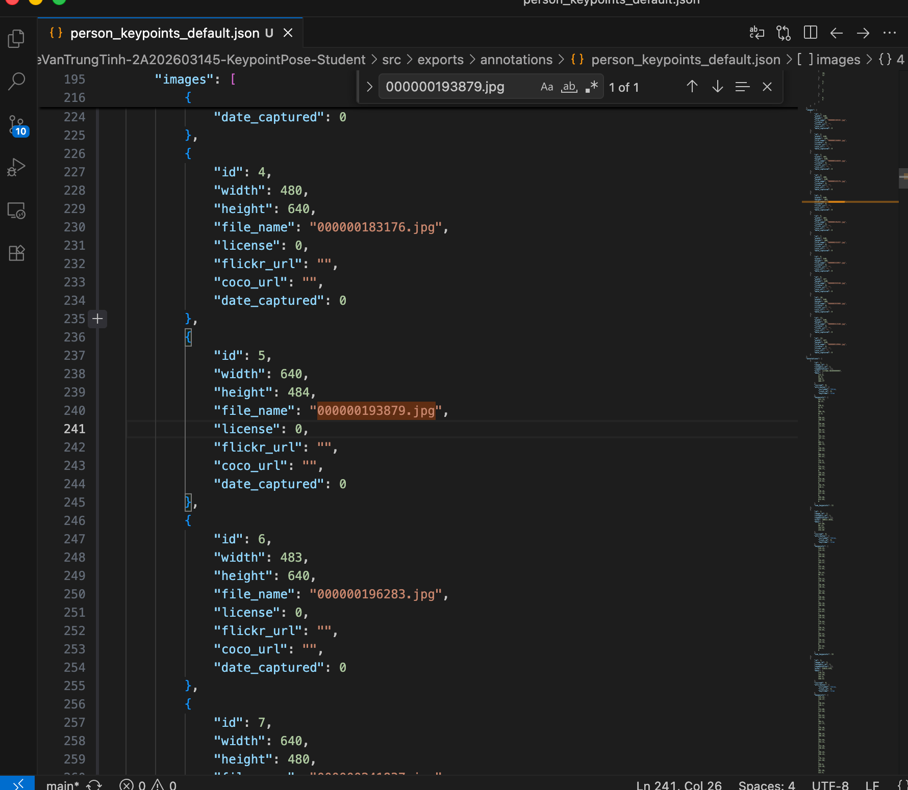

# Báo cáo cá nhân — LeVanTrungTinh-2A202603145

Dữ liệu: 12 ảnh người COCO val2017 (Lin et al., 2014) và 8 ảnh chân dung Wikimedia Commons, chỉ dùng trong lớp.

## 0. Thông tin học viên

- Họ tên: Le Van Trung Tinh
- MSSV: 2A202603145
- Email: levantrungtinh13@gmail.com
- Link repository: https://github.com/tinhne/K5-L2-DAY4-LeVanTrungTinh-2A202603145-KeypointPose-Student
- Phiên bản CVAT (Help → About): Không lưu lại phiên bản cụ thể; giao diện sử dụng là CVAT 2.x.
- Máy: macOS · RAM 16 GB · chạy CVAT đầy đủ bằng Docker
- Bộ ảnh (`src/exports/assignment.json` do `lab.py setup` tạo): có
- Giờ bắt đầu: 16h20
- Giờ kết thúc: 17h45

## 1. Kiểm tra label (CP0)

| Label    | Kiểu     | Số điểm | Tên điểm đúng bảng của lab? | Đúng thứ tự? | Số cạnh |
| -------- | -------- | ------: | --------------------------- | ------------ | ------: |
| `person` | skeleton |      17 | Có                          | Có           |      19 |
| `face`   | skeleton |      13 | Có                          | Có           |      13 |

Mẫu `person` dựng theo người quay mặt về camera (các điểm `left_*` nằm bên phải khung mẫu)? Có

Cách đổi cờ `occluded` / `outside` cho **một điểm** trên phiên bản CVAT này (một câu):

Trong CVAT, chọn điểm cần sửa rồi bật/tắt cờ `occluded` hoặc `outside` trong thuộc tính của điểm.

## 2. Số lượng đã gán và thời gian (CP1, CP2)

| Nhóm ảnh   | Số ảnh | Số skeleton đã gán | Số người dưới 60 px (không gán) | Số poster / gương / màn hình bỏ qua | Thời gian (phút) |
| ---------- | -----: | -----------------: | ------------------------------: | ----------------------------------: | ---------------: |
| `easy`     |      5 |                  5 |                               0 |                                   0 |               10 |
| `occluded` |      3 |                  4 |                               0 |                                   0 |               20 |
| `back`     |      2 |                  3 |                               0 |                                   0 |               15 |
| `small`    |      1 |                  1 |                               0 |                                   0 |                8 |
| `crowd`    |      1 |                  3 |                               0 |                                   0 |               15 |
| `faces`    |      8 |                  8 |                               — |                                   0 |               12 |

- Số ảnh người đã xong ở mốc phút 105: 12/12
- Thời gian thực tế (phút): CP1 10 (mạng khá lag nên clone lâu) · CP2 40 · CP3 30
- Ảnh tốn thời gian nhất là ảnh nào, vì sao? ảnh 000000413160.jpg, vì 3 người đều ngồi chèo chèo tư thế nghiên, cả hơi quay lưng và ngồi che nhau.

Tổng thời gian thao tác theo các checkpoint là 80 phút; khoảng 5 phút còn lại
dùng để mở/đồng bộ CVAT và xuất file.

## 3. Bảng ca khó (CP1, CP2)

Mỗi điểm bạn phân vân một dòng, nhất là phân vân giữa `v = 1` và `v = 0`, hoặc không chắc hướng người.

| Ảnh              | Người / mặt | Điểm        | Cờ đã chọn | Phân vân giữa | Lý do chọn                                                                                 |
| ---------------- | ----------- | ----------- | ---------: | ------------- | ------------------------------------------------------------------------------------------ |
| 000000164659.jpg | người       | ankle       |          2 | 0 hoặc 1      | Công cụ tự kiểm cảnh báo cặp ankle có thể bị đảo trái/phải; cần đối chiếu trực tiếp ảnh.   |
| 000000193879.jpg | người       | ankle       |          2 | 0 hoặc 1      | Công cụ tự kiểm cảnh báo cặp ankle có thể bị đảo trái/phải; cần đối chiếu trực tiếp ảnh.   |
| 000000343057.jpg | người       | knee, ankle |          2 | 0 hoặc 1      | Công cụ tự kiểm cảnh báo các cặp này có thể bị đảo trái/phải; cần đối chiếu trực tiếp ảnh. |

## 4. Bảng tự review (CP3)

Đi từ ảnh cuối về ảnh đầu. 5 ảnh người (ít nhất 2 ảnh `back` hoặc `crowd`) và 3 ảnh mặt. Ít nhất 8 dòng, kể cả dòng `ok`. Ghi lỗi trước, sửa sau.

Mã lỗi dùng đúng một trong: `lr_swap`, `vis_flag`, `position`, `missing`, `extra`, `ok`.

| Ảnh              | Người / mặt | Điểm  | Mã lỗi  | Ghi chú                             | Đã sửa?                 |
| ---------------- | ----------- | ----- | ------- | ----------------------------------- | ----------------------- |
| 000000413160.jpg | người       | —     | ok      | Tự kiểm không báo lỗi               | Có                      |
| 000000359340.jpg | người       | —     | ok      | Tự kiểm không báo lỗi               | Có                      |
| 000000193879.jpg | người       | ankle | lr_swap | Cảnh báo tự kiểm, cần đối chiếu ảnh | Tay đang bắt chéo thật  |
| 000000183176.jpg | người       | —     | ok      | Tự kiểm không báo lỗi               | Có                      |
| 000000164659.jpg | người       | ankle | lr_swap | Cảnh báo tự kiểm, cần đối chiếu ảnh | Chân đang bắt chéo thật |
| face_79591.jpg   | mặt         | —     | ok      | Tự kiểm không báo lỗi               | Có                      |
| face_559185.jpg  | mặt         | —     | ok      | Tự kiểm không báo lỗi               | Có                      |
| face_436791.jpg  | mặt         | —     | ok      | Tự kiểm không báo lỗi               | Có                      |

Tổng hợp số lỗi theo mã:

| `lr_swap` | `vis_flag` | `position` | `missing` | `extra` | `ok` |
| --------: | ---------: | ---------: | --------: | ------: | ---: |
|         2 |          0 |          0 |         0 |       0 |    6 |

Điểm còn phân vân giữa `v = 1` và `v = 0` (ghi cả hai lựa chọn và lý do chọn):

Các cặp được cảnh báo (ankle ở `000000164659.jpg`, `000000193879.jpg`; knee và ankle ở
`000000343057.jpg`) cần được đối chiếu trực tiếp với ảnh trước khi kết luận đổi trái/phải.

## 5. Kiểm file xuất và kết quả tự kiểm (CP4)

Tự kiểm tay trong file JSON:

| File                         | Người / mặt kiểm (ảnh, thứ tự) | Số phần tử `keypoints` | Điểm `outside` ra `v = 0`, `occluded` ra `v = 1`? | `num_keypoints` khớp? |
| ---------------------------- | ------------------------------ | ---------------------: | ------------------------------------------------- | --------------------- |
| `LeVanTrungTinh_persons.zip` | 000000150192.jpg, thứ tự 1     |                     51 | Có                                                | Có                    |
| `LeVanTrungTinh_persons.zip` | 000000413160.jpg, thứ tự 3     |                     51 | Có                                                | Có                    |
| `LeVanTrungTinh_faces.zip`   | face_79591.jpg, thứ tự 8       |                     39 | Có                                                | Có                    |

Sau khi xuất, CVAT ghi `occluded` thành `v = 1` và `outside` thành `v = 0`. Tọa độ
của điểm `outside` trong file là tọa độ cũ (75 điểm `v = 0` vẫn giữ tọa độ cũ).

Hai job đã chuyển sang completed trên CVAT? Có, đã xuất thành công cả hai job.

Dán phần **TÓM TẮT** in ra từ `src/check_submission.py`:

```text
- File person: LeVanTrungTinh_persons.zip; 12 ảnh, 17 skeleton `person`, mỗi annotation 51 số.
  Skeleton theo ảnh: 000000150192=1, 000000156069=1, 000000164659=1,
  000000183176=1, 000000193879=2, 000000196283=1, 000000241837=1,
  000000343057=1, 000000359340=1, 000000393909=2, 000000413160=3,
  000000518966=2. Cờ v: v=2 180 (62%), v=1 42 (15%), v=0 67 (23%).
  `num_keypoints` trung bình: 13.1.
- File face: LeVanTrungTinh_faces.zip; 8 ảnh, 8 skeleton `face`, mỗi annotation 39 số.
  Cờ v: v=2 92 (88%), v=1 4 (4%), v=0 8 (8%). `num_keypoints` trung bình: 12.0.
- Ghi chú: 75 điểm v=0 vẫn mang tọa độ cũ (CVAT 2.x xuất như vậy).
- Số [LỖI]: 0 · số [CẢNH BÁO]: 3. Kết quả: ĐẠT.
```

Các `[CẢNH BÁO]` còn giữ nguyên và lý do:

Ba cảnh báo trái/phải của `000000164659.jpg`, `000000193879.jpg` và
`000000343057.jpg` được giữ nguyên để kiểm tra thủ công trên ảnh.

## 6. Ảnh chụp màn hình

1. Label `person` trong label constructor (đủ 17 điểm có tên):

   Không có ảnh chụp label constructor trong các file hiện có.

2. Một người quay lưng đã gán, cờ đã đặt:

   

3. Một khuôn mặt đã gán 13 điểm, phóng to vùng mắt:

   

4. Một đoạn JSON xuất của một người:

   

Nguồn ảnh: COCO val2017 / Wikimedia Commons.

## 7. Tự đánh giá

1. Lỗi bạn mắc nhiều nhất hôm nay, và cách bạn sẽ tránh ở dự án thật:

   Lỗi dễ gặp là đảo trái/phải ở người quay góc hoặc bị che. Tôi sẽ đối chiếu các cặp
   flip-pair và chạy tự kiểm trước khi xuất.

2. Một quy tắc bạn đề xuất thêm vào guideline (kèm ảnh ví dụ nếu có):

   Bổ sung quy tắc: khi một cặp trái/phải bị khuất hoặc bắt chéo, phải kiểm tra theo
   hướng của người trong ảnh và ghi lại lý do trong bảng ca khó.

3. Nhãn của bạn đi vào model ở đâu? Chọn một lỗi bạn đã sửa và nói nó sẽ làm model học sai thế nào (heatmap, trọng số trong loss, hay bước lật ảnh):

   Nhãn được dùng để huấn luyện heatmap keypoint. Đảo trái/phải làm heatmap của điểm
   bị gán sang vị trí đối xứng, khiến mô hình học sai vị trí và phép lật dữ liệu.

## 8. Khó khăn và lỗi kỹ thuật

Không ghi nhận lỗi kỹ thuật nghiêm trọng. CVAT chạy được bằng Docker và xuất được
hai file COCO; ảnh chụp màn hình đầu tiên ghi lại trạng thái các container CVAT.

## Bonus (nếu làm)

### B1 — 3 ảnh người khó thêm

| Ảnh                                                  | Số skeleton | Số người dưới 60 px | Ca khó nhất                                         |
| ---------------------------------------------------- | ----------: | ------------------: | --------------------------------------------------- |
| 000000073537.jpg, 000000104800.jpg, 000000125998.jpg |           8 |                   0 | Kiểm tra điểm khuất và điểm ngoài khung |
| —                                                    |           — |                   — | —                                                   |
| —                                                    |           — |                   — | —                                                   |

Kết quả `src/check_submission.py` cho `LeVanTrungTinh_bonus_persons.zip`:

```text
- File person: 3 ảnh, 8 skeleton `person`, mỗi annotation 51 số.
  Skeleton theo ảnh: 000000073537=2, 000000104800=3, 000000125998=3.
  Cờ v: v=2 53 (39%), v=1 9 (7%), v=0 74 (54%).
  `num_keypoints` trung bình: 7.8.
- Số [LỖI]: 0 · số [CẢNH BÁO]: 0. Kết quả: ĐẠT.
```

### B2 — 5 ảnh khuôn mặt đen trắng / hồng ngoại

Đã làm bonus B2 với 5 ảnh khuôn mặt. Kết quả: 5 skeleton `face`, mỗi annotation
39 số; v=2: 58 (89%), v=0: 7 (11%), `num_keypoints` trung bình: 11.6.
Ảnh đen trắng/hồng ngoại làm giảm tương phản và khó xác định biên mắt, mũi, môi.
Kính râm vẫn gán `v=1` nếu vị trí điểm bị che nhưng có thể ước lượng hợp lý; nếu
điểm nằm ngoài ảnh thì dùng `outside` với `v=0`.

## 9. Tài liệu tham khảo và công cụ AI đã dùng

- COCO val2017, Lin et al. (2014).
- Wikimedia Commons (bộ ảnh chân dung của lab).
- CVAT, định dạng COCO Keypoints 1.0.
- Công cụ tự kiểm: `src/check_submission.py`.
- AI hỗ trợ điền báo cáo từ các file và kết quả tự kiểm trong repository.

### B3 — Model so với nhãn của tôi (không tính điểm)

- Demo đã dùng: Không thực hiện.
- Ảnh đã thử: Không thực hiện.

1. Model có trả điểm cho khớp bị che, hay khớp ngoài ảnh không? Confidence ở các điểm đó thế nào?

   Không thực hiện.

2. Với người quay lưng, model có đổi trái/phải không?

   Không thực hiện.

3. Bộ điểm của model có giống 17 điểm COCO không?

   Không thực hiện.
